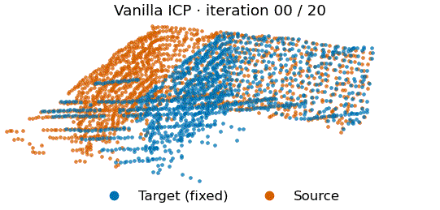

# CUDA-accelerated ICP

Align two LiDAR point clouds using point-to-point ICP, then accelerate the same
five-stage algorithm with native CUDA. The CPU implementation provides the
reference for evaluating CUDA correctness and performance.



## Results

KITTI sequence 00, frame 1 → 0, 124,605 source points and 124,668 target points.
20 iterations. CPU: AMD EPYC 9534. GPU: NVIDIA L40S.
Timing covers the complete Step 1–5 loop only; setup, logging and final
evaluation are excluded on both targets. One run per method.

<!-- execution-time-results:start -->

| Method | Execution time (ms) | Translation error | Rotation error | Inliers |
| --- | ---: | ---: | ---: | ---: |
| CPU serial | 300,596.867 | 24.08 cm | 0.12556° | 123,329 |
| CUDA brute-force | 253.918 | 24.08 cm | 0.12556° | 123,329 |
| CUDA tiled brute-force | 129.478 | 24.08 cm | 0.12556° | 123,329 |
| CUDA KDtree | TBD | TBD | TBD | TBD |
| CUDA voxel-grid | TBD | TBD | TBD | TBD |


<!-- execution-time-results:end -->

## Build and run

```sh
make cpu RUN=1                         # CPU vanilla, brute-force search
make gpu SEARCH=brute-force RUN=1      # CUDA naive brute force
make gpu SEARCH=tiled RUN=1            # CUDA shared-memory tiled search
make gpu SEARCH=all RUN=1              # Run naive and tiled searches
make gpu SEARCH=voxel-grid RUN=1       # CUDA voxel-grid correspondence search
```

Omit `RUN=1` to compile only. `make cuda` is an alias for `make gpu`.
The two GPU searches are explicit executable commands in `tests/run_gpu.sh`;
CPU uses `tests/run_cpu.sh`. No Python build wrapper is used.

Run the shell scripts directly to compile and execute:

```sh
bash tests/run_cpu.sh
bash tests/run_gpu.sh                  # Runs both CUDA searches by default
SEARCH=tiled bash tests/run_gpu.sh
```

The scripts compile and run directly on the current local machine. They do not
request a scheduler allocation or impose a runtime limit.

```sh
make gpu SEARCH=all RUN=1 SOURCE=data/000002.bin TARGET=data/000001.bin
```

Each invocation saves build and execution output to a uniquely named log under
`scripts/result/`. Earlier result folders were also moved there; paths recorded
inside historical evidence refer to their original locations.

A C++17 compiler is required. Eigen 3.4.0 headers are bundled in
[`third_party/eigen/`](third_party/eigen/README.md), including their licenses.
They are included in GitHub Download ZIP as well as Git clones; no separate
Eigen installation or download is needed. CPU builds require CMake >=3.18.
GPU builds use CMake >=3.18 when available, or compile directly with `nvcc`
when CMake is absent. Set `BUILD_SYSTEM=direct` to force the direct GPU build.
GPU builds additionally require an NVIDIA GPU, driver and compatible CUDA
toolkit. `nvcc` is found on PATH; set `CUDACXX` if needed. No cluster-specific
paths are embedded in the scripts. CPU/GPU CMake builds and direct GPU builds
use the bundled Eigen headers by default. Direct GPU builds optionally accept
`EIGEN3_INCLUDE_DIR` to use another directory containing `Eigen/Core`.

For a server without CMake (P100, architecture 60):

```sh
CUDACXX=/usr/local/cuda/bin/nvcc CUDA_ARCHITECTURES=60 \
    BUILD_SYSTEM=direct make gpu SEARCH=all RUN=1
```

The GPU architecture is detected from the first GPU reported by `nvidia-smi`;
set `CUDA_ARCHITECTURES` to override it (for example, `86`).

Defaults are source `data/000001.bin`, target `data/000000.bin`. Both executables
read KITTI float32 XYZI through `load_kitti()`; ICP uses XYZ. See
[data format](data/README.md). CPU feature remains available with
`make cpu METHOD=feature RUN=1`; current work focuses on vanilla.

CPU vanilla is capped at 20 iterations; CPU feature and CUDA retain 100.
For a matched vanilla comparison, override the iteration cap for either executable:

```sh
ICP_BENCHMARK=1 ICP_ITERATIONS=20 make cpu RUN=1
ICP_BENCHMARK=1 ICP_ITERATIONS=20 make gpu SEARCH=all RUN=1
```

Benchmark mode forces exactly 20 iterations and disables iteration logging,
point dumps and per-iteration timers. A single host monotonic-clock interval
covers the entire loop, including CUDA host SVD and pose update. Ordinary runs
retain early stopping and iteration logging. CPU feature has separate options.

Release CPU/CUDA builds and a matched 20-iteration comparison passed execution
on an NVIDIA L40S. See [CPU/CUDA accuracy and latency](docs/CPU_CUDA_COMPARISON.md).
Historical full-cloud vanilla converged at 69 iterations; see
[validation](docs/CPU_PAIR_VALIDATION.md).

## Project layout

```text
src_cpu/common/      Shared CPU types, I/O and pose operations
src_cpu/vanilla/     CPU point-to-point reference
src_cpu/feature/     CPU KD-tree, features, residuals and LM
src_gpu/common/      Device allocation, I/O and host pose operations
src_gpu/vanilla/     CUDA point-to-point kernels and host solver
src_gpu/feature/     Future implementation boundary (currently unsupported)
scripts/             Saved-pose 3D visualization
tests/               CPU/GPU compile and run shell scripts
docs/                Algorithm design, memory/thread diagrams and historical evidence
data/               Six bundled binary frames and format guide
```

Each implementation owns its header and build files. The root CMake build selects
CPU by default or CUDA with `-DICP_ENABLE_CUDA=ON`. Build and run scripts are
in `tests/`.

See [vanilla ICP design](docs/VANILLA_DESIGN.md),
[existing CUDA optimizations](docs/VANILLA_OPTIMIZATIONS.md), and
[documentation map](docs/README.md). The [draft guide](docs/DRAFT.md) and
[recorded validation](docs/DRAFT_VALIDATION.md) describe earlier development stages.

Earlier implementations remain available in Git history at
[`d46bb94`](https://github.com/sangjae4309/icp-cuda-accel/tree/d46bb9486a361bebdfdb6ab7ad84d9a561bf9b1b).

## Contributing

See [CONTRIBUTE.md](CONTRIBUTE.md).

## Iteration logs and optional point dumps

Vanilla always prints each completed iteration's time and writes an
`iterations.csv` into a new run directory under `scripts/result/`.
The console prints `iteration_results=...` with the exact directory.
Each CSV row also records the updated pose and convergence flag.

- CPU: `time_ms` measures steps 1–5 using `CLOCK_MONOTONIC`.
- GPU: `time_ms` uses `cudaEvent` in the kernel stream, from pose upload through
  steps 1–3 and statistics download. Host SVD and pose update are excluded.
  It is a CUDA-event interval, not a sum of kernel-only durations; stream idle
  time between host submissions may also contribute.
- In ordinary runs, setup, final evaluation and writes are outside per-iteration
  timing but inside complete-call time. Benchmark mode disables all per-iteration
  recording and times the whole loop once, including host Step 4–5 for CUDA.
  Initial allocation/upload, final evaluation and cleanup are outside that loop.
- Filesystem errors are reported as `ICP_IO_ERROR`; timing rows describe
  completed updates, not partially failed iterations.

CPU point snapshots are enabled only with `dump`:

```sh
make cpu RUN=1                         # Times and poses only
make cpu dump RUN=1                    # Times, poses and local point CSVs
make dump                             # Same as CPU vanilla + dump + run
ICP_DUMP=1 bash tests/run_cpu.sh        # Shell equivalent
make gpu SEARCH=all RUN=1              # CUDA-event times, no point dumps
```

```text
scripts/result/cpu-<unique-id>/
    iterations.csv       # iteration, time_ms, converged, R, t
    target.csv           # fixed local target points (dump only)
    source_0000.csv      # local source at initial pose (dump only)
    source_0001.csv      # same source points after iteration 1
    source_0002.csv      # same source points after iteration 2
    ...
```

The CPU dump window is X [8,11], Y [-8.5,-5.5], Z [-2,1] meters, matching the
previous 3 m close-up bounds. It selects all points inside this window in each
original cloud. Source selection remains fixed across iterations, even if a
transformed point leaves the window. This includes all local points, not the
older figure's sample conditioned on its final pose. Coordinates are written as
`point_index,x,y,z`, preserving original point indices. A snapshot uses the
updated pose after step 5, not the pre-update step-1 coordinates. Point dumps
are CPU vanilla only; GPU does not download or dump per-point coordinates even
when `dump` is supplied. The optional CPU feature method does not support dumps.

CPU/GPU timing paths were built and executed in the
[20-iteration comparison](docs/CPU_CUDA_COMPARISON.md). CPU coordinate dumping
was disabled for that comparison and remains untested at runtime.


## CUDA search selection

Search selection is at runtime, without `#ifdef` implementation branches:
`make SEARCH=...` -> shell executable argument -> parseSearch -> Step 2 switch.

| SEARCH | Executable argument | State |
| --- | --- | --- |
| brute-force | cuda-naive | implemented |
| tiled | cuda-tiled | implemented |
| kd-tree | cuda-kd-tree | FILL ME; ICP_NOT_IMPLEMENTED |
| voxel-grid | cuda-voxel-grid | implemented; opt-in |

`SEARCH=all` runs the brute-force and tiled searches. Voxel-grid is currently
opt-in; it builds a target hash grid once per registration and searches the
27 cells around each transformed source point. Cell width is just above the
configured maximum correspondence distance. If no candidate is within that
cutoff, it scans the target cloud to preserve the exact nearest distance for the
rejected point.
The KD-tree function remains a placeholder in
`src_gpu/vanilla/icp_step2_kdtree.cu`; selecting it returns
`ICP_NOT_IMPLEMENTED`:

```sh
make gpu SEARCH=kd-tree RUN=1
```

The voxel-grid and brute-force searches preserve the smallest-target-index tie
rule. Voxel-grid runtime and accuracy results are not yet measured. This CUDA
search is independent of the existing CPU feature KD-tree.
The benchmark table above does not yet include voxel-grid measurements.
