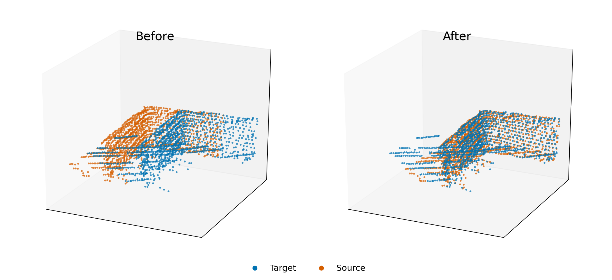
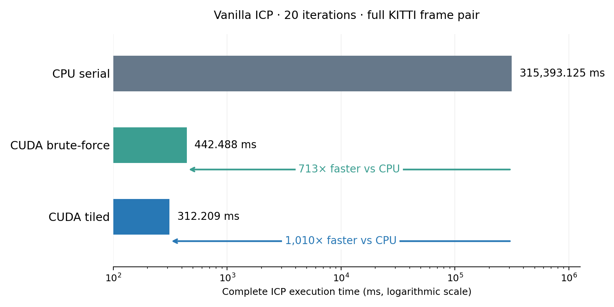

# CUDA-accelerated ICP

Align two LiDAR point clouds using point-to-point ICP, then accelerate the same
five-stage algorithm with native CUDA. The CPU implementation provides the
reference for evaluating CUDA correctness and performance.



KITTI sequence 00, frame 1 aligned to frame 0. Blue: target; orange: source.
The same local points and camera are used before and after. This example uses
saved full-cloud CPU results from 69 iterations; the current CPU default is 20.
See [validation results](docs/CPU_PAIR_VALIDATION.md) for pose errors and settings.

## Results

KITTI sequence 00, frame 1 → 0, all 124,605 source and 124,668 target points,
20 iterations, identity initialization, 1 m cutoff. CPU: one serial run on
AMD EPYC 9534. GPU: median of three runs on NVIDIA L40S. Times measure the
complete registration call, excluding file loading and compilation.

<!-- execution-time-results:start -->

| Method | Execution time (ms) | Runs | Statistic |
| --- | ---: | ---: | --- |
| CPU serial | 315,393.125 | 1 | single |
| CUDA brute-force | 442.488 | 3 | median |
| CUDA tiled | 312.209 | 3 | median |



<!-- execution-time-results:end -->

| Accuracy metric | CPU serial | CUDA brute-force | CUDA tiled |
| --- | ---: | ---: | ---: |
| Translation error | 24.08 cm | 24.08 cm | 24.08 cm |
| Rotation error | 0.12556° | 0.12556° | 0.12556° |
| Inliers | 123,329 | 123,329 | 123,329 |

All three methods returned the same final pose, 123,329 inliers and
0.142262415058 m RMSE at printed precision. None converged within 20 iterations.
These are the existing measurements; KD-tree and voxel-grid remain unmeasured.
See [accuracy, timing scopes and evidence](docs/CPU_CUDA_COMPARISON.md).

The table and plot are parsed from [scripts/result.csv](scripts/result.csv).
Regenerate them without running ICP:

```sh
python3 scripts/plot_execution_time.py
```

## Build and run

```sh
make cpu RUN=1                         # CPU vanilla, brute-force search
make gpu SEARCH=brute-force RUN=1      # CUDA naive brute force
make gpu SEARCH=tiled RUN=1            # CUDA shared-memory tiled search
make gpu SEARCH=all RUN=1              # Run both CUDA searches, one after another
```

Omit `RUN=1` to compile only. `make cuda` is an alias for `make gpu`.
The two GPU searches are explicit executable commands in `tests/run_gpu.sh`;
CPU uses `tests/run_cpu.sh`. No Python build wrapper is used.

Run the shell scripts directly to compile and execute:

```sh
bash tests/run_cpu.sh
bash tests/run_gpu.sh                  # Runs both CUDA searches by default
SEARCH=tiled bash tests/run_gpu.sh
```

The scripts compile and run directly on the current local machine. They do not
request a scheduler allocation or impose a runtime limit.

```sh
make gpu SEARCH=all RUN=1 SOURCE=data/000002.bin TARGET=data/000001.bin
```

Each invocation saves build and execution output to a uniquely named log under
`scripts/result/`. Earlier result folders were also moved there; paths recorded
inside historical evidence refer to their original locations.

A C++17 compiler, CMake >=3.18 and Eigen3 are required. GPU builds additionally
require an NVIDIA GPU, driver and compatible CUDA toolkit. `nvcc` is found on
PATH; set `CUDACXX` if needed. If Eigen is outside the standard search paths,
set `CMAKE_PREFIX_PATH` to its installation prefix. No cluster-specific paths
are embedded in the scripts.

The GPU architecture is detected from the first GPU reported by `nvidia-smi`;
set `CUDA_ARCHITECTURES` to override it (for example, `86`).

Defaults are source `data/000001.bin`, target `data/000000.bin`. Both executables
read KITTI float32 XYZI through `load_kitti()`; ICP uses XYZ. See
[data format](data/README.md). CPU feature remains available with
`make cpu METHOD=feature RUN=1`; current work focuses on vanilla.

CPU vanilla is capped at 20 iterations; CPU feature and CUDA retain 100.
For a matched vanilla comparison, override the iteration cap for either executable:

```sh
ICP_ITERATIONS=20 make cpu RUN=1
ICP_ITERATIONS=20 make gpu SEARCH=all RUN=1
```

This retains the usual early stopping and changes only the maximum iteration
count. The CPU feature method retains its separate options.

Release CPU/CUDA builds and a matched 20-iteration comparison passed execution
on an NVIDIA L40S. See [CPU/CUDA accuracy and latency](docs/CPU_CUDA_COMPARISON.md).
Historical full-cloud vanilla converged at 69 iterations; see
[validation](docs/CPU_PAIR_VALIDATION.md).

## 3D visualization

```sh
python3 scripts/visualize_registration.py
```

The script reads original `.bin` frames and an existing result JSON with
`T_target_source`; edit SOURCE, TARGET, RESULT and OUT at its top for another run.
It generates a 3D overview, fixed-camera close-up PNG and before/after toggle GIF
under `scripts/result/` (generated files are ignored by Git). The GIF alternates saved endpoint poses; it does
not replay ICP iterations. No registration is performed by the visualizer.
The default result is the existing local full-cloud vanilla result; fresh clones
must supply their own saved pose JSON. NumPy, Matplotlib and Pillow are required.

`make cpu` invokes `tests/run_cpu.sh`; `make gpu` invokes `tests/run_gpu.sh`.
Add `RUN=1` for execution. Previous preprocessing, benchmark, download, evaluation and Python
unit-test scripts were removed; historical validation records refer to their
original revisions.

To animate recorded iterations instead of toggling only the endpoints:

```sh
python3 scripts/animate_iterations.py
```

Set RUN at the top to the recorded run directory. The script uses point dumps
when available; otherwise it reconstructs coordinates from `iterations.csv`
poses and the original binary clouds. It includes the initial state and every
recorded update, with fixed point selection and camera, and performs no ICP run.
The default output is `scripts/result/cpu-g5dVQq-iterations.gif`.

## Project layout

```text
src_cpu/common/      Shared CPU types, I/O and pose operations
src_cpu/vanilla/     CPU point-to-point reference
src_cpu/feature/     CPU KD-tree, features, residuals and LM
src_gpu/common/      Device allocation, I/O and host pose operations
src_gpu/vanilla/     CUDA point-to-point kernels and host solver
src_gpu/feature/     Future implementation boundary (currently unsupported)
scripts/             Saved-pose 3D visualization
tests/               CPU/GPU compile and run shell scripts
docs/                Algorithm design, memory/thread diagrams and historical evidence
data/               Local binary frames and format guide
```

Each implementation owns its header and build files. The root CMake build selects
CPU by default or CUDA with `-DICP_ENABLE_CUDA=ON`. Source-local C++ test folders
were removed at the user's request; the root Python tool tests remain.

See [vanilla ICP design](docs/VANILLA_DESIGN.md),
[existing CUDA optimizations](docs/VANILLA_OPTIMIZATIONS.md), and
[documentation map](docs/README.md). The [draft guide](docs/DRAFT.md) and
[recorded validation](docs/DRAFT_VALIDATION.md) describe earlier development stages.

Earlier implementations remain available in Git history at
[`d46bb94`](https://github.com/sangjae4309/icp-cuda-accel/tree/d46bb9486a361bebdfdb6ab7ad84d9a561bf9b1b).

## How to contribute

We use topic branches and pull requests, inspired by
[gem5's contribution workflow](https://www.gem5.org/contributing).
Our integration branch is `main` (gem5 uses `develop`). Do not push work directly
onto `main`; submit a focused PR and obtain a teammate's review before merging.

| Item | Project convention | Example |
|---|---|---|
| Branch | `<area>/<short-change>` in lowercase kebab-case | `integration/update-draftcode` |
| Commit title | `<area>: <change>` | `integration: update draftcode` |
| PR title | Same format as commit title | `integration: update draftcode` |

The colon format comes from gem5's **commit** convention, not its branch naming.
The slash-based branch convention is our project rule: Git forbids colons and
spaces in branch names. Use areas such as `integration`, `transform`,
`correspondence`, `statistics`, `solver`, `validation`, or `docs`.

1. Pick a task from [TASKS.md](docs/TASKS.md) and coordinate its owner.
2. Update `main`, then create a branch for that task.
3. Implement and test the change; keep unrelated work in separate PRs.
4. Commit, push the branch, and open a pull request targeting `main`.
5. Describe the change and test evidence, request a teammate's review, and address
   feedback on the same branch. Merge only after approval and applicable checks.

```sh
git switch main
git pull --ff-only origin main
git switch -c integration/update-draftcode
# Edit files and run the relevant checks.
git add <changed-files>
git commit -m "integration: update draftcode"
git push -u origin integration/update-draftcode
```

On GitHub, choose **Compare & pull request**, set base `main` and compare
`integration/update-draftcode`, then use `integration: update draftcode` as the title.
With an authenticated GitHub CLI, the equivalent is:

```sh
gh pr create --base main --head integration/update-draftcode \
  --title "integration: update draftcode" --body-file /tmp/icp-pr.md
```

Write the PR description into `/tmp/icp-pr.md` first. See the full
[contribution guide](docs/CONTRIBUTING.md) for validation, review, and fork workflows.

Agent guidance, reusable workflows and documentation policy are routed by
[the documentation map](docs/README.md).


## Output fields

`execution_time_ms` measures the complete registration call using the host
monotonic clock: workspace setup, iterations, final-pose evaluation and cleanup.
For CUDA this includes transfers and host work; it is not kernel-only timing.
Input-file loading, build time and console printing are excluded.
`inliers` counts original source points whose final nearest target is within the
1 m cutoff. Matches are many-to-one and are not verified physical correspondences.
`rmse` is computed over those final inliers. `converged=0` with `iterations=20`
means the CPU iteration budget was exhausted before the convergence criterion.

## Iteration logs and optional point dumps

Vanilla always prints each completed iteration's time and writes an
`iterations.csv` into a new run directory under `scripts/result/`.
The console prints `iteration_results=...` with the exact directory.
Each CSV row also records the updated pose and convergence flag.

- CPU: `time_ms` measures steps 1–5 using `CLOCK_MONOTONIC`.
- GPU: `time_ms` uses `cudaEvent` in the kernel stream, from pose upload through
  steps 1–3 and statistics download. Host SVD and pose update are excluded.
  It is a CUDA-event interval, not a sum of kernel-only durations; stream idle
  time between host submissions may also contribute.
- Setup, final error evaluation and log/point-file writes are outside per-iteration
  timing. `execution_time_ms` still measures the entire registration call,
  including logging/dumping overhead, so these are different timing scopes.
- Filesystem errors are reported as `ICP_IO_ERROR`; timing rows describe
  completed updates, not partially failed iterations.

CPU point snapshots are enabled only with `dump`:

```sh
make cpu RUN=1                         # Times and poses only
make cpu dump RUN=1                    # Times, poses and local point CSVs
make dump                             # Same as CPU vanilla + dump + run
ICP_DUMP=1 bash tests/run_cpu.sh        # Shell equivalent
make gpu SEARCH=all RUN=1              # CUDA-event times, no point dumps
```

```text
scripts/result/cpu-<unique-id>/
    iterations.csv       # iteration, time_ms, converged, R, t
    target.csv           # fixed local target points (dump only)
    source_0000.csv      # local source at initial pose (dump only)
    source_0001.csv      # same source points after iteration 1
    source_0002.csv      # same source points after iteration 2
    ...
```

The CPU dump window is X [8,11], Y [-8.5,-5.5], Z [-2,1] meters, matching the
previous 3 m close-up bounds. It selects all points inside this window in each
original cloud. Source selection remains fixed across iterations, even if a
transformed point leaves the window. This includes all local points, not the
older figure's sample conditioned on its final pose. Coordinates are written as
`point_index,x,y,z`, preserving original point indices. A snapshot uses the
updated pose after step 5, not the pre-update step-1 coordinates. Point dumps
are CPU vanilla only; GPU does not download or dump per-point coordinates even
when `dump` is supplied. The optional CPU feature method does not support dumps.

CPU/GPU timing paths were built and executed in the
[20-iteration comparison](docs/CPU_CUDA_COMPARISON.md). CPU coordinate dumping
was disabled for that comparison and remains untested at runtime.


## CUDA search selection

Search selection is at runtime, without `#ifdef` implementation branches:
`make SEARCH=...` -> shell executable argument -> parseSearch -> Step 2 switch.

| SEARCH | Executable argument | State |
| --- | --- | --- |
| brute-force | cuda-naive | implemented |
| tiled | cuda-tiled | implemented |
| kd-tree | cuda-kd-tree | FILL ME; ICP_NOT_IMPLEMENTED |
| voxel-grid | cuda-voxel-grid | FILL ME; ICP_NOT_IMPLEMENTED |

`SEARCH=all` runs only the implemented brute-force and tiled searches. The two
placeholder functions are in `src_gpu/vanilla/icp_step2_kdtree.cu` and
`icp_step2_voxel_grid.cu`. They do not perform a search or return a successful
registration. Select them explicitly to enter the placeholder path:

```sh
make gpu SEARCH=kd-tree RUN=1
make gpu SEARCH=voxel-grid RUN=1
```

These are CUDA vanilla stubs, independent of the existing CPU feature KD-tree.
No build or execution was performed for this placeholder addition; earlier
CPU/CUDA comparison results describe the preceding implementation revision.
