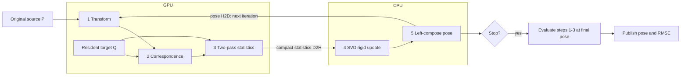
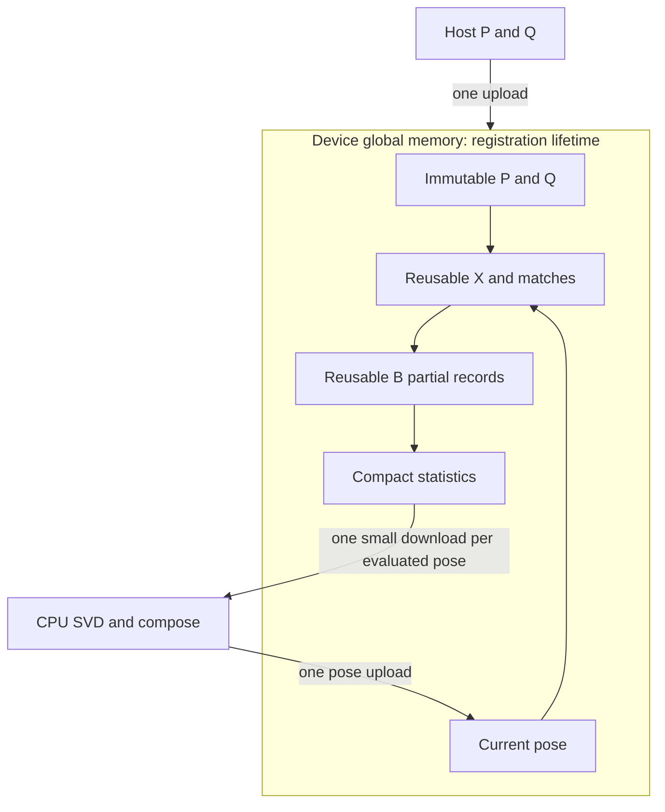
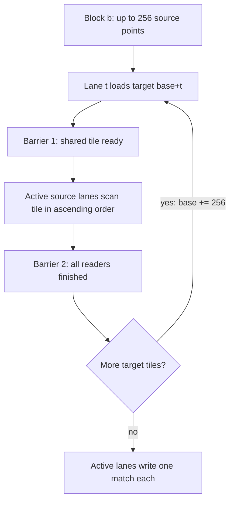

# Vanilla ICP design and ownership

Status: ownership and solver choices approved on 2026-11-16. The user subsequently
restricted work to analysis and visualization to protect contributors. On 2026-11-17 the user resumed implementation of unfinished stages. The code is
now written but compilation and numerical validation remain pending.
Source: [CUDA-Accelerated ICP Registration](CUDA-Accelerated-ICP-Registration.pdf),
pages 6–9. Feature-based preprocessing and optimization (pages 10–12) are deferred.

## Five algorithm steps

1. **Transform (page 6).** Recompute `x_i = R_k p_i + t_k` from immutable original
   source. Evaluate using double pose arithmetic and cast each coordinate to float.
2. **Correspondence (page 7).** Minimize float squared distance; many source points
   may select the same target. Naive and tiled search scan all targets. CUDA
   voxel-grid search hashes targets once, with cell width just above the configured
   maximum correspondence distance, then scans the source point's 27 neighboring
   cells. This contains every possible in-cutoff match; if there is none, it scans
   all targets to preserve the exact nearest-distance output for rejected points.
   Accept `distance² <= cutoff²`;
   rejected entries have index -1. All searches preserve the smallest-target-index
   tie rule.
3. **Statistics (page 8).** Over valid matches, accumulate count K, SSE and both
   coordinate sums in double. Divide sums by K for centroids. In a second pass,
   accumulate `H = sum((x-mu_x)*(q-mu_q)^T)` in double. Count repeated target
   selections separately. Transfer compact statistics to CPU, as the PDF specifies.
4. **Rigid update (page 9).** Host SVD `H=U*S*V^T`. Form
   `delta_R=V*diag(1,1,det(V*U^T))*U^T` and
   `delta_t=mu_q-delta_R*mu_x`. Proposed implementation: Eigen JacobiSVD on the
   3x3 double matrix; do not form H^T H or invert singular values manually.
5. **Compose (page 9).** Left-compose `R_next=delta_R*R_current` and
   `t_next=delta_R*t_current+delta_t`. Stop when both translation norm and rotation
   angle are within their configured tolerances, unless fixed iterations are requested.

After the final update, repeat transform, correspondence and statistics at the final
pose before publishing `sqrt(SSE/K)` and `T_target_source`. A stale iteration error
must not be reported as final RMSE. Preserve the original source throughout.

Proposed solver policy: require at least three valid pairs; reject nonfinite input
and rank below two, accept non-collinear planar geometry. Use the second singular
value relative to the first (proposed threshold 1e-12) to identify numerical rank.
Use a clamped cosine and atan2-based rotation angle; compare tolerances inclusively.
These approved future choices resolve details not specified in the PDF; they remain unimplemented.

## Five-step execution diagram

## GPU memory lifetime

Allocate once before the loop and free once after final evaluation. Original P/Q
are uploaded once. Reuse all scratch buffers. Default-stream kernel order and
synchronous statistics download provide the required sequencing.

| Device buffer | Payload estimate | Lifetime / use |
|---|---:|---|
| Original source, target | 12N + 12M bytes | Immutable throughout registration |
| Transformed source | 12N | Rewritten at each pose |
| Match indices, squared distances | 8N | Rewritten after each transform |
| Pose | 96 | Uploaded at every evaluated pose |
| Statistics | 136 | Reduced on GPU, downloaded for CPU solve |
| Centroid and covariance partials | 136B | Reused by statistics kernels |

Here B=ceil(N/256). Estimates assume the ordinary int/float/double ABI; allocations
use actual sizeof. Total device payload is approximately `32N+12M+136B+232` bytes,
excluding runtime overhead, shared memory and registers. No N-by-M matrix is stored.

## CUDA threads and blocks

Existing transform and brute-force searches use 256 threads per block, eight warps. Thread
`i=blockIdx.x*256+threadIdx.x` owns source i. Transform has no shared memory.
Tiled search holds one source and its running best candidate per thread, and
loads 256 target points cooperatively into 3072 bytes of shared memory per block.
Voxel-grid construction and queries also use one thread per target/source point;
the target hash heads and per-target linked-list entries are allocated once for a
registration. Query chains filter hash collisions by exact integer voxel
coordinates.

Inactive source lanes still load target slots and reach both barriers. A partial
last target tile is scanned only to its valid length. Shared tiles are private to
each CUDA block. All blocks scan the complete target cloud; no target locking.

Proposed statistics implementation: four ordered kernels. First reduce valid
count, SSE and sums within each 256-thread source block; then one block reduces
B partials and writes centroids. Next reduce nine centered covariance terms per
source block, then one block reduces the covariance partials. Finalization lanes
consume partials with stride 256. Inactive lanes contribute zero and participate
in every barrier. Use explicit loops and shared-memory trees; no atomics or
per-iteration allocation. CPU serial and GPU tree sums need numerical tolerance,
not bitwise equality. Occupancy, latency and speedup remain unmeasured.

## Proposed file ownership

| Owner | Responsibility and exclusive files |
|---|---|
| integration | Root and CPU/GPU CMake, headers, io, main, icp_run; CPU CUDA stubs; GPU cuda_memory |
| cpu-reference | Both icp_gold.cpp files: serial steps 1–3 and host workspace |
| transform | GPU transform_kernel.cu: step 1 |
| correspondence | GPU correspondence_kernel.cu: step 2, naive/tiled variants |
| statistics | GPU statistics_kernel.cu: step 3 |
| rigid-update | Both icp_solver.cpp files: steps 4–5 and convergence |
| validation | Both tests/test_draft.cpp files and tests/test_tools.py |

Steps 4 and 5 share a translation unit and one owner. CPU stages likewise share
one owner. No source split or concurrent writers are needed. The exact proposed
paths and dependencies are in `.agent/block-plan.json`. Each generated owner's
memory contains the corresponding equations, input/output contracts, precision,
edge cases, source locators and verification limits above.

Use direct functions, structs and loops. Keep essential input, allocation, CUDA
status and numerical-validity checks; avoid exception frameworks, repeated internal
validation and speculative fallbacks. Existing transform/NN arithmetic stays intact.
Implementation completion covers statistics, solver, composition/convergence, final
result publication, necessary CMake dependency wiring and focused correctness cases.
Builds and GPU execution require separate current authorization under Slurm policy.
