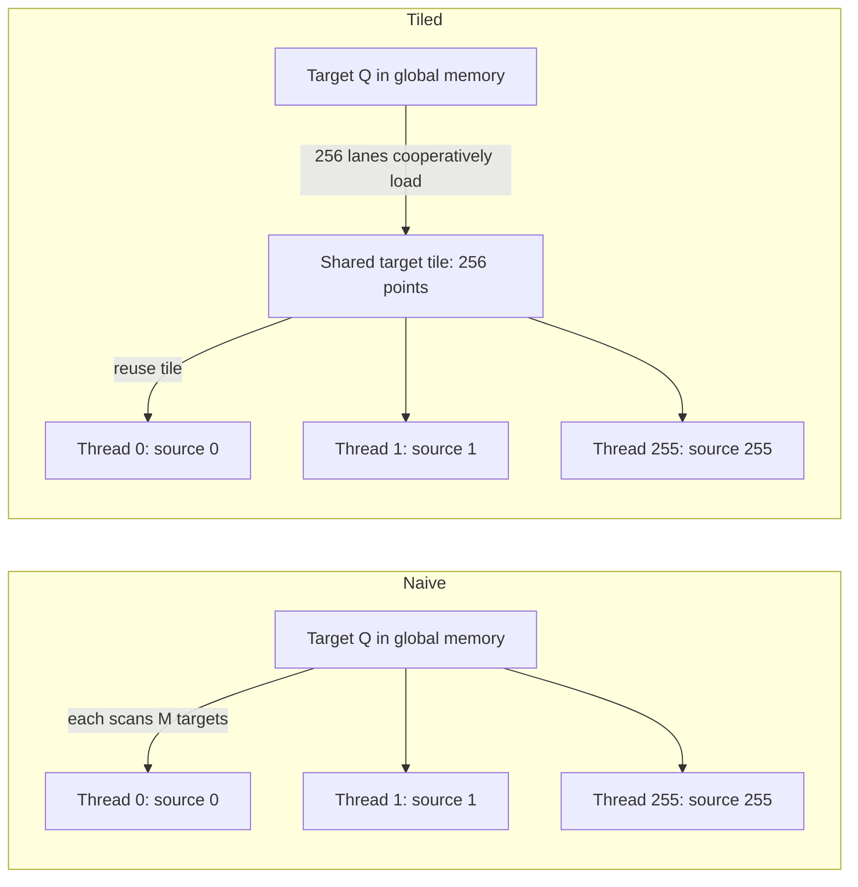
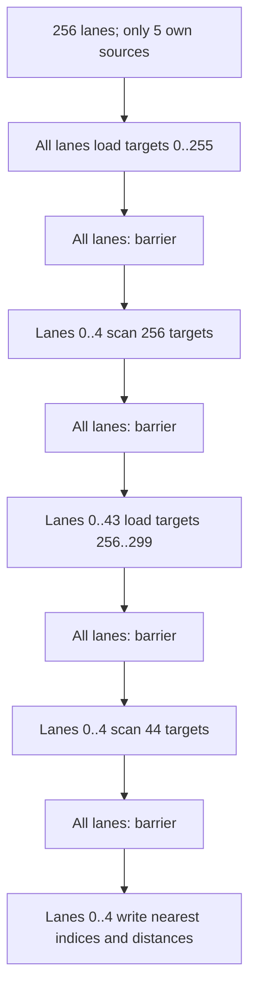

# Existing vanilla ICP optimizations

Read-only analysis on 2026-11-16, HEAD a8ca470, after fetching origin without
merging or modifying source. No benchmarks, builds or GPU tests ran. This report
explains implemented source; it does not establish measured speedup.

## Contribution provenance

The implementation author is **Nathanael Smith**. Sangjae Park's later merge
commits integrate this work; they do not change its implementation authorship.

| Commit | Contribution |
|---|---|
| aa6760a | CPU/CUDA transform, precision-preserving build flags and transform tests |
| 0831972 | CPU exhaustive nearest neighbor and naive CUDA search, exact matching tests |
| 6c141aa | Shared-memory tiled CUDA search and partial-tile/tie/barrier-sensitive tests |

Current CPU/GPU source matches the tree at 6c141aa. Persistent allocations and
one-time P/Q upload predate these contributions. At the time of this analysis, statistics, rigid solving and final evaluation
were unfinished. They were implemented on 2026-11-17; this report continues to
describe Smith's unchanged transform/search commits.
See [the PDF-based five-step design](VANILLA_DESIGN.md) for the full algorithm,
GPU buffer lifetime, and proposed future reductions.

## What changes between naive and tiled search

Both variants assign one thread to one transformed source point. Each thread loads
that source once, scans all targets and retains only its nearest distance/index.
Tiling changes how target points reach the threads, not which points are searched.

Each block owns its own shared tile. For a target tile starting at base, lane t
loads Q[base+t] into tile[t]. After a barrier, active source lanes scan the valid
tile entries in order. A second barrier prevents a fast warp overwriting data
still being read by another warp. Repeat until every target has been visited.

### Partial blocks: why idle source lanes remain active loaders

For N=5 and M=300 there is one 256-thread block, but only lanes 0–4 have a source.
All 256 lanes must still help load the first target tile. On the second tile,
lanes 0–43 load targets 256–299; all lanes execute both barriers. Only lanes 0–4
compute distances and write matches. Returning early in lanes 5–255 would break
this cooperative load/barrier protocol.

## Cost model, not a performance measurement

Let B=ceil(N/256) and C=ceil(M/256).

| Source-level quantity | Naive | Tiled |
|---|---:|---:|
| Distance evaluations | NM | NM |
| Logical target Point fetches from global pointer | NM | BM |
| Logical shared target Point reads | 0 | NM |
| Barriers per block | 0 | 2C |
| Target shared storage per block | 0 | 3072 bytes |

The logical global target-fetch ratio is N/B, approaching 256 for full source
blocks. **This is neither a DRAM-traffic measurement nor a speedup.** Naive warp
lanes request the same target index together, allowing hardware/cache reuse.
Tiled search adds shared reads/writes, barriers and bookkeeping. Small inputs,
cache-resident targets and partial blocks can make those costs important.
Registers, actual memory transactions, occupancy and time are unmeasured.

## Transform and numerical preservation

The transform kernel maps 256 threads per block to independent source points.
It reads a source point into local double coordinates, applies the double pose,
and casts once to float. It never updates original P in place. An out-of-range
transform lane can return because this kernel has no barriers.

Both matching variants preserve ascending target order and strict `<`, including
exact ties across tile boundaries. Many-to-one matching remains valid. Cutoff is
inclusive and rejection retains the nearest squared distance while writing -1.
CPU/GPU distance expression order matches. C++ `-ffp-contract=off` and CUDA
`-fmad=false` preserve this numerical contract; disabling contraction may cost
performance and must not be silently reversed. The FLT_MAX initial minimum does
not guarantee a candidate when all computed distances overflow or are nonfinite.

## Tests present in the commits

- Transform: identity/known rigid transforms, immutable source, N=257, sentinel
  tails and CPU/GPU comparisons.
- Correspondence: exact float distances, ties, cutoff boundaries, many-to-one,
  rejection behavior and CPU/naive/tiled comparisons.
- Tiled cases: N=5/M=300; N=257 with M=256,257,300,512; late nearest targets;
  equal nearest targets at indices 5 and 260, requiring index 5.

These are inspected test cases, not newly executed passes. Earlier infrastructure
validation predates these kernels. The current task preserves all executable
source and tests, including existing checks and comments. Human contributors
retain control of their code; generated agent ownership is coordination only.
