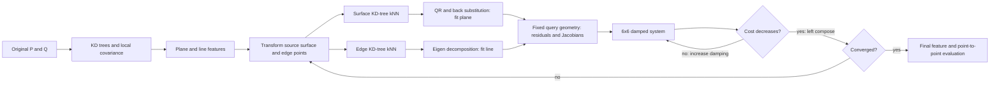

# CPU feature ICP

PDF-flow implementation, CPU validated on 2026-11-17 with GCC 8.5.0 / Eigen 3.3.7.
Source: `src_cpu/feature/`. CUDA feature ICP is not implemented.

```sh
PARTITION=interactive CMAKE_PREFIX_PATH=/common/software/install/manual/eigen/3.3.7 make cpu METHOD=feature RUN=1
```

The positional executable interface is
`icp_run source.xyz target.xyz feature`; omitting the method retains vanilla.
SEARCH selects vanilla variants only; feature always uses its own KD tree.

## Pipeline aligned with PDF pages 11–12

The PDF specifies the stage order, not numerical thresholds or a QR plane
parameterization. The following choices make those missing details explicit.

1. Page 11: build source/target KD trees and compute centered local covariance
   from up to 20 neighbors excluding the query within 2 m (at least 3 required).
   With eigenvalues l1 >= l2 >= l3, classify edge if (l1-l2)/l1 >= 0.8,
   otherwise surface if (l2-l3)/l1 >= 0.5, otherwise corner if l3/l1 >= 0.5.
   Other points are unselected. These ratios operationalize the slide's
   qualitative eigenvalue patterns; their exact values are implementation choices.
2. Build separate target surface and edge KD trees from the selected points.
   Corners are classified but unused: page 12 specifies only surface/edge branches.
3. On every iteration transform each original source surface/edge point, then
   query up to 20 same-kind target points within 1 m. Require at least 3 neighbors.
   Fit geometry from that query's entire neighbor set, not from one precomputed
   target feature. There is no source/target normal-direction gate.
4. Surface branch: compute neighbor centroid c and centered offsets y=q-c.
   Choose dependent axis k whose complementary 2D covariance minor has largest
   determinant. Solve y_k = a*y_u + b*y_v by column-pivoted Householder QR and
   triangular back substitution. Reject rank < 2. The unit normal is proportional
   to e_k-a*e_u-b*e_v; the plane passes through c. Centering and axis selection
   allow vertical planes and planes through the origin. This is coordinate
   least squares, not orthogonal PCA plane fitting. The PDF does not prescribe
   the plane parameterization; this is the chosen QR formulation.
5. Edge branch: eigendecompose the queried neighbor covariance and take the
   largest-eigenvalue eigenvector through its centroid. Require the same 0.8
   linearity criterion. Reject query-to-plane/line distances above 1 m.
6. Feed plane/line residuals into LM. Fix neighbors and fitted geometry during
   trial acceptance; after an accepted update, transform, query and fit again.
7. Recompute matches and fitted geometry at the final pose. Separately evaluate
   all source points using the unchanged vanilla float nearest-neighbor metric.

Defaults live in `src_cpu/feature/icp.h`; feature keeps its own 100-iteration
limit, with 1e-6 pose tolerances from common options. Parameters were chosen without tuning to KITTI ground
truth. Coordinates remain float; fitting and optimization use double. The slide's
5K+ surfaces/500+ edges describe workload sizes, not enforced counts; our bundled
input has only 2048 points per cloud. There are no descriptors, robust weights,
motion compensation, or coarse-to-fine stages.

The original implementation below is retained as historical evidence. It used
precomputed target PCA geometry and a nearest-compatible-feature direction gate;
it did not implement the PDF's per-query QR/eigen fitting flow.

## Residuals and LM

Column vectors, x=R*p+t, increment order [v,omega], and left update
T_new=exp(hat(delta))*T. The point Jacobian is [I,-skew(x)].

- Plane: r=n^T(x-a), J=n^T[I,-skew(x)].
- Line: P=I-dd^T, r=P(x-a), J=P[I,-skew(x)].
- Cost: F=0.5*sum(||r||^2), unit weight per feature.
- A=sum(J^T J), g=sum(J^T r), solve (A+lambda*diag(A))*delta=-g.

The implementation scales columns by 1/sqrt(diag(A)), rejects an unobservable
normalized Hessian with smallest eigenvalue <=1e-10 times largest, and uses LDLT.
The exact SE(3) exponential includes the translation Jacobian V with small-angle
series. Damping starts at 1e-3. Accept positive actual reduction with positive
predicted reduction; reduce lambda by 3 for gain>0.75, double for gain<0.25;
rejected trials multiply it by 10. Clamp to [1e-12,1e12], at most 10 trials.
Exhausted trials return ICP_DEGENERATE with the last pose unchanged.

Convergence checks the undamped Gauss-Newton increment against translation and
rotation tolerances, so a large damping value alone cannot fake convergence.
Matches and feature weights remain fixed throughout accept/reject comparisons.
A single plane is insufficient to determine six pose degrees of freedom and is
reported as degenerate. Fewer than six matched features returns insufficient matches.



## Historical baseline verification and measured limits

CPU Slurm job 7488020 on acn09 completed successfully. Evidence is in
`results/feature-cpu-check/run.log`, `run.sh` and `check.cpp`; source and binary
hashes are in `provenance.json`. Source-local test directories were not recreated.

Checks passed: exact KD versus exhaustive neighbors (including ties and radius),
analytic normal equations versus finite-difference residual Jacobians, known
mixed-plane/line LM pose recovery, single-plane rank rejection, three-plane
end-to-end pose recovery, and line feature extraction. End-to-end synthetic case:
4 iterations, 99 plane matches, point-to-point RMSE 6.18223994949e-7 m, feature
RMSE 5.75191471431e-8 m. These tests do not establish correctness for every input.

Same bundled KITTI pair, identity initialization, 1 m cutoff, 100-iteration limit:

| Metric | Vanilla | Feature baseline |
|---|---:|---:|
| Iterations | 21 | 7 |
| Converged | yes | yes |
| Final point-to-point inliers | 1756 | 1744 |
| Point-to-point RMSE (m) | 0.501347943001 | 0.511101733291 |
| Feature matches | N/A | 295 plane + 131 line |
| Feature geometric RMSE (m) | N/A | 0.28565562937 |

Feature extraction found source 471 planes/364 lines and target 394 planes/419
lines. Feature RMSE is sqrt(sum squared geometric distances / matched features),
not per scalar residual component. It is not comparable to vanilla point RMSE.
The point-to-point inlier sets also differ. Iteration counts are not speedup.
These geometric residuals alone cannot rank translation/rotation accuracy; the
ground-truth comparison below evaluates pose directly.
The feature method does not currently improve the measured point-to-point metric;
this could reflect different objectives, feature selection/correspondences, or
unresolved issues beyond the synthetic checks. No parameters were adjusted to
improve this KITTI result. GPU execution and feature performance remain unverified.


## Historical baseline KITTI ground-truth comparison (2026-11-17)

The user supplied official-format odometry poses and calibration under
`/projects/standard/zhenman/shared/home/sangjae4309/kitti/`:
`poses/dataset/poses/00.txt` and `calib/dataset/sequences/00/calib.txt`.
The bundled pair is sequence 00, source frame 1, target frame 0. With camera
poses W_i and camera-from-LiDAR calibration C = Tr, the reference is
`T_gt = inverse(C) * inverse(W_0) * W_1 * C`.
Its LiDAR translation is approximately (0.858768, 0.046516, 0.022240) m.

Existing job 7488020 outputs were evaluated without rerunning or tuning ICP.
`scripts/kitti_relative_pose.py` generated the reference;
`scripts/evaluate.py` evaluated `E = inverse(T_gt) * T_est` using translation
norm and rotation trace angle.

| Pose error (lower is better) | Vanilla | Feature baseline |
|---|---:|---:|
| Translation (m) | 0.138137651443 | 0.333035361705 |
| Rotation (degrees) | 0.071504933703 | 0.402585528055 |

The current feature baseline is worse on both pose metrics for this pair.
The difference cannot be explained solely by the geometric objective used for
reporting RMSE. Its cause remains undiagnosed: synthetic checks do not rule out
real-data correspondence, feature-quality or implementation problems. This is
one relative-pose comparison, not the KITTI trajectory benchmark or a general
ranking of feature methods. Ground truth was used only for evaluation.

Evidence: `results/kitti-gt-check/T_target_source_gt.txt`, `vanilla.json`,
`feature.json`, `vanilla-error.json`, `feature-error.json` and `provenance.json`.
Provenance records hashes of input clouds, original run log, evaluation scripts,
pose file and calibration. To reevaluate either saved result:

```bash
python3 scripts/evaluate.py --result results/kitti-gt-check/vanilla.json --gt results/kitti-gt-check/T_target_source_gt.txt
python3 scripts/evaluate.py --result results/kitti-gt-check/feature.json --gt results/kitti-gt-check/T_target_source_gt.txt
```


## PDF-flow revision: evaluation (2026-11-17)

CPU job 7489014 on ahn2 built the revision and passed the existing KD-tree,
finite-difference Jacobian, mixed plane/line known-pose, rank-deficiency and full
synthetic recovery checks. Added checks cover QR planes through the origin in
all three coordinate charts, changed query neighborhoods changing fitted
centroids, per-query edge eigen fitting, collinear plane rejection, and corner
classification. The end-to-end synthetic result converged in 4 iterations with
point RMSE 6.18454157947e-7 m and feature RMSE 5.75222151069e-8 m.
These checks preserve the previous tolerances.

Same 2048-point KITTI sequence 00 pair, identity initialization, 1 m cutoff and
100-iteration limit; ground truth used only for post-run evaluation:

| Metric | Vanilla | Previous feature baseline | PDF-flow feature |
|---|---:|---:|---:|
| Translation error (m) | 0.138137651443 | 0.333035361705 | 0.301632049097 |
| Rotation error (degrees) | 0.071504933703 | 0.402585528055 | 0.626876303721 |
| Iterations | 21 | 7 | 13 |
| Point-to-point inliers | 1756 | 1744 | 1738 |
| Point-to-point RMSE (m) | 0.501347943001 | 0.511101733291 | 0.511649023107 |
| Plane / line matches | N/A | 295 / 131 | 131 / 34 |
| Feature RMSE (m) | N/A | 0.285655629370 | 0.178449428053 |

All three reported convergence. The revised feature method improves translation
relative to the previous baseline, worsens rotation, and remains worse than
vanilla on both pose metrics. Its smaller feature RMSE uses a different set of
constraints and does not establish better pose accuracy. Source/target feature
counts remain unchanged (471/364 and 394/419 surface/edge); only 165 fitted
constraints survive the new neighbor geometry requirements. Sparse neighborhoods
are a possible limitation, not a proven explanation for the error. No parameters
were tuned to this pair, and this is not a trajectory benchmark.

Evidence: `results/feature-pdf-check/run.sh`, `check.cpp`, `run.log`,
`vanilla.json`, `feature.json`, `vanilla-error.json`, `feature-error.json`, and
`provenance.json`. `before-sha256.json` establishes that only four files under
`src_cpu/feature/` changed; vanilla and CUDA sources were preserved.
The GT transform and its original input hashes remain in `results/kitti-gt-check/`.
GPU execution was not performed.

Python data/calibration/evaluation tool tests also passed (5 tests), CPU job
7489035; evidence: `results/feature-pdf-check/tools-test.log`.


## Full original-cloud follow-up

The user subsequently requested every original point. Both unchanged methods
were evaluated in CPU job 7489138; canonical results and preprocessing distinctions
are in [full-cloud CPU validation](../CPU_PAIR_VALIDATION.md#full-original-frames-2026-11-17).
Feature pose errors improve over the reduced-input run; full-cloud feature has
smaller translation error than full-cloud vanilla, but larger rotation error.
Evidence: `results/full-cloud-check/`. No GT tuning or algorithm changes.
